# TetraGate

**A four-channel LoRa gateway with a touch display, a browser console, and
authenticated sensor nodes — built from scratch on STM32.**

Four RFM95W radios listen on four different frequencies at the same time.
Each one has its own SPI bus and its own FreeRTOS task, so a node is never
waiting for a shared radio and one dead module cannot take down the other
three. What they hear appears on a 2.8" touch screen on the device itself,
and on a browser console on a PC over a single USB cable.

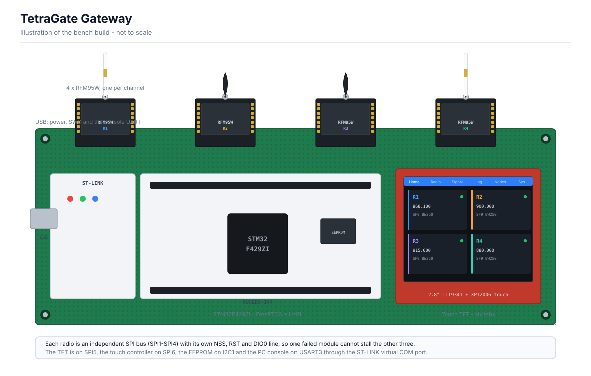

> **Just want to try it?** [Release v1.0.0](../../releases/tag/v1.0.0) has
> prebuilt firmware for the gateway and all four node identities — no
> toolchain needed. Those images are built with the *published example
> key*, so they are for evaluation, not deployment; see
> [§12](#12-security).

---

## Contents

| | |
|---|---|
| [1. What it is](#1-what-it-is) | the whole system in one table |
| [2. Architecture](#2-architecture) | how the pieces fit together |
| [3. Hardware](#3-hardware) | schematics, parts, pin maps |
| [4. The radio link](#4-the-radio-link) | frame format, channels, authentication |
| [5. Gateway firmware](#5-gateway-firmware) | boot, tasks, the code that matters |
| [6. Node firmware](#6-node-firmware) | the five-second cycle |
| [7. The touch display](#7-the-touch-display) | all six screens |
| [8. The PC console](#8-the-pc-console) | all five pages |
| [9. The JSON interface](#9-the-json-interface) | how the text is generated |
| [10. User guide](#10-user-guide) | first power-up to first packet |
| [11. Build and flash](#11-build-and-flash) | toolchain, both projects |
| [12. Security](#12-security) | what the MIC does and does not do |
| [13. Limitations](#13-limitations-read-this-before-deploying) | read before deploying |
| [14. Repository layout](#14-repository-layout) | where everything lives |

Deeper documents live in [`docs/`](docs/) — this README is the tour, those
are the manuals.

---

## 1. What it is

| | Gateway | Node |
|---|---|---|
| **MCU** | STM32F429ZIT6 (NUCLEO-144) | STM32G030F6P6 (7Semi Anchor) |
| **Core** | Cortex-M4F @ 168 MHz | Cortex-M0+ @ 64 MHz |
| **Memory** | 2 MB flash, 256 kB RAM | 32 kB flash, 8 kB RAM |
| **Radios** | 4 × RFM95W (SX1276) | 1 × RFM95W |
| **Scheduler** | FreeRTOS, 7 tasks | bare metal, no RTOS |
| **Display** | 2.8" ILI9341 + XPT2046 touch | one status LED |
| **Storage** | AT24C256 EEPROM, A/B config slots | compile-time constants |
| **Link out** | USART3 → ST-LINK virtual COM → PC | — |
| **Watchdog** | IWDG, 8 s, per-task check-in | IWDG, 8 s |

**Measured on the bench, at the time of writing:**

| | R1 | R2 | R3 | R4 |
|---|---|---|---|---|
| Frequency | 868.100 MHz | 900.000 MHz | 915.000 MHz | 880.000 MHz |
| Node | 1001 | 1002 | 1003 | 1004 |
| Accepted | 668 | 651 | 653 | 642 |
| CRC errors | **221** | 0 | 0 | 0 |
| RSSI | −55 dBm | −35 dBm | −62 dBm | −59 dBm |

That 221 on R1 is real and it is explained in
[§13](#13-limitations-read-this-before-deploying) — 868.100 MHz is the
busiest LoRa channel in the world, and the gateway is hearing other
people's equipment.

---

## 2. Architecture

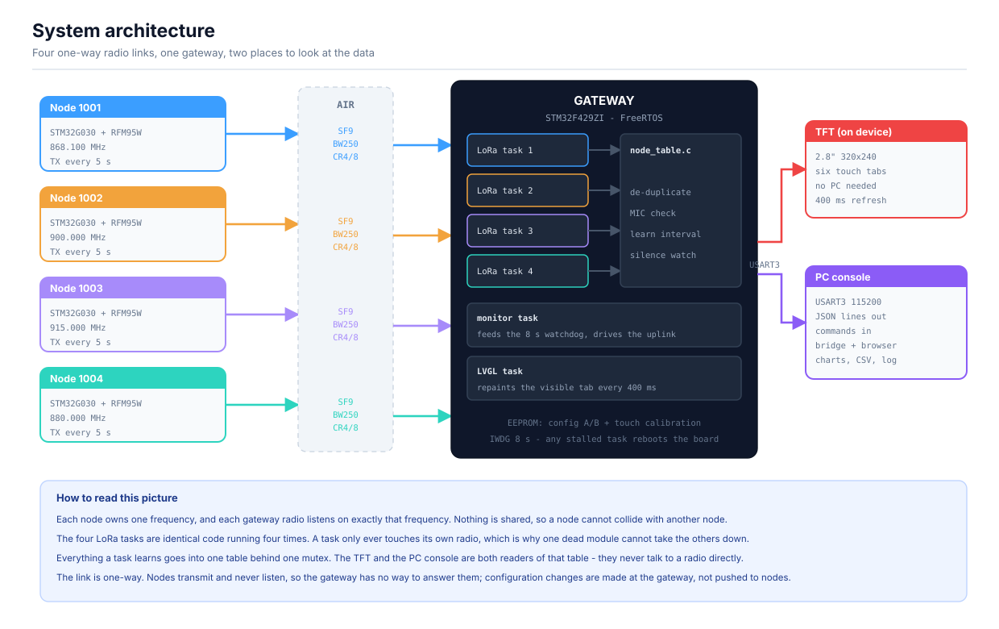

Four ideas carry the whole design:

**One node, one frequency, one radio.** Nothing is shared, so two nodes
can never collide and no node ever waits for a busy receiver. The cost is
that the channel plan is fixed at build time on the node side.

**The four LoRa tasks are the same code, four times.** A task only ever
touches its own SPI bus and its own radio. It never draws anything and
never writes to the UART. This is why the GUI can be rewritten without any
risk to packet reception.

**Everything converges on one table behind one mutex.** `node_table.c`
holds one row per node. The display and the PC console are both *readers*
of that table — neither talks to a radio directly.

**The link is one-way.** Nodes transmit and immediately return to standby.
They never listen, so the gateway cannot acknowledge, reconfigure, or
address a node. Configuration happens at the gateway.

### Life of one packet

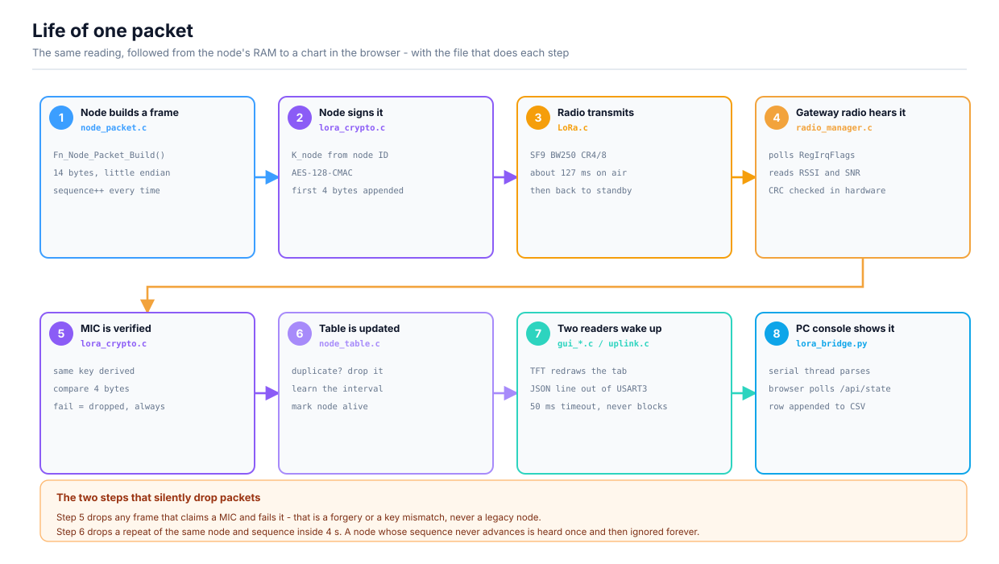

Two of those eight steps drop packets *silently*, which makes them the
first places to look when something disappears:

- **Step 5** drops any frame that claims a MIC and fails it.
- **Step 6** drops a repeat of the same node and sequence within 4 s.

---

## 3. Hardware

### Gateway

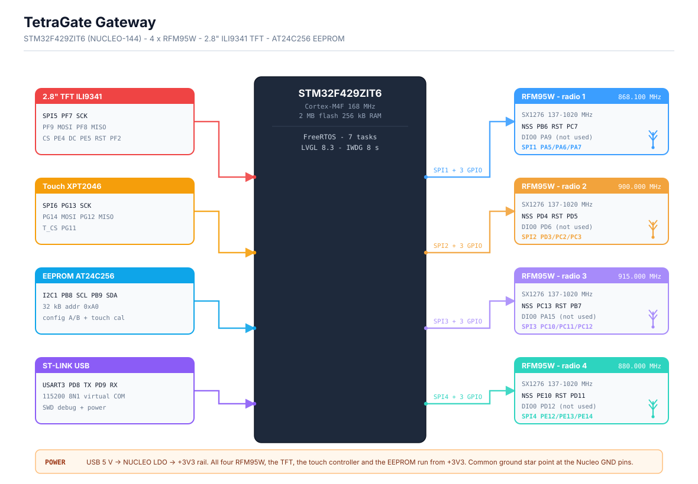

Every pin below is read out of the firmware, not from memory — the radio
pins come from `Gateway/Core/Inc/main.h` and the per-radio binding in
[`utils.c`](Gateway/Core/Src/utils.c), and the bus pins from the CubeMX
`MspInit` blocks.

| Radio | Bus | SCK | MISO | MOSI | NSS | RST | DIO0 |
|---|---|---|---|---|---|---|---|
| 1 | SPI1 | PA5 | PA6 | PA7 | PB6 | PC7 | PA9 |
| 2 | SPI2 | PD3 | PC2 | PC3 | PD4 | PD5 | PD6 |
| 3 | SPI3 | PC10 | PC11 | PC12 | PC13 | PB7 | PA15 |
| 4 | SPI4 | PE12 | PE13 | PE14 | PE10 | PD11 | PD12 |

| Peripheral | Bus | Pins |
|---|---|---|
| ILI9341 TFT | SPI5 | PF7 SCK, PF8 MISO, PF9 MOSI, CS PE4, DC PE5, RST PF2 |
| XPT2046 touch | SPI6 | PG13 SCK, PG12 MISO, PG14 MOSI, T_CS PG11 |
| AT24C256 EEPROM | I2C1 | PB8 SCL, PB9 SDA |
| PC console | USART3 | PD8 TX, PD9 RX — 115200 8N1 |

DIO0 is wired on every radio but **not used**: reception is polled from
`RegIrqFlags` instead. The lines are there so a future revision can move
to interrupts without touching the board.

### Node

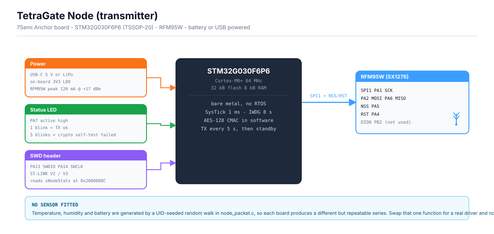

| Signal | Pin |
|---|---|
| SPI1 SCK / MOSI / MISO | PA1 / PA2 / PA6 |
| RFM95W NSS | PA5 |
| RFM95W RST | PA4 |
| RFM95W DIO0 | PB2 (not used) |
| Status LED | PA7 |
| SWD | PA13 SWDIO, PA14 SWCLK |

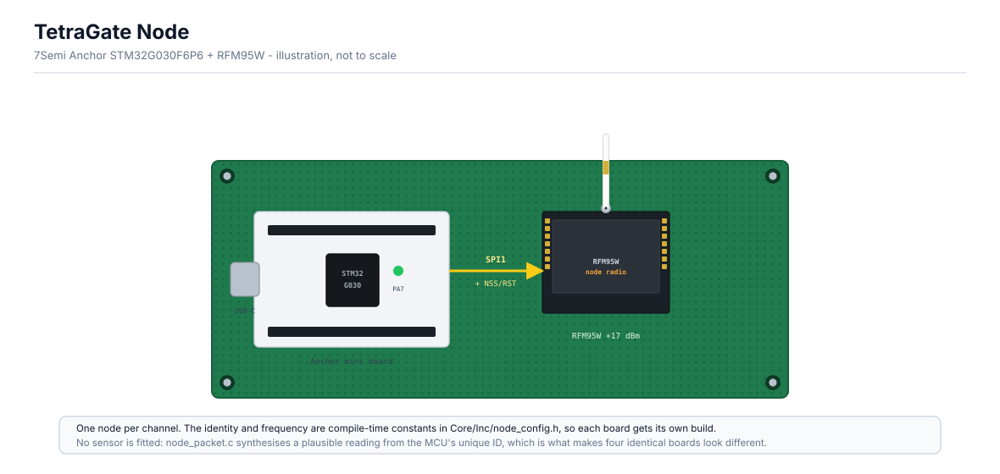

### Bill of materials

| Qty | Part | Notes |
|---|---|---|
| 1 | NUCLEO-F429ZI | gateway MCU board, has the ST-LINK on it |
| 4 | RFM95W breakout | 868/915 MHz SX1276 modules |
| 4 | 868/915 MHz antenna | SMA whip or stub |
| 1 | 2.8" ILI9341 TFT with XPT2046 | SPI, resistive touch |
| 1 | AT24C256 I²C EEPROM | 32 kB |
| 1 | perfboard + standoffs | |
| *n* | 7Semi Anchor STM32G030F6P6 | one per node |
| *n* | RFM95W + antenna | one per node |

Datasheets for all the key parts are in [`Datasheets/`](Datasheets/).

---

## 4. The radio link

### Channel plan

| Radio | Frequency | Node | Why |
|---|---|---|---|
| R1 | 868.100 MHz | 1001 | EU868 channel 0 |
| R2 | 900.000 MHz | 1002 | clear gap |
| R3 | 915.000 MHz | 1003 | top of the tuning range |
| R4 | 880.000 MHz | 1004 | clear gap |

Modem settings are the same on all four: **SF9, BW 250 kHz, CR 4/8, sync
word 0x12, +17 dBm, 10-symbol preamble.** All of SF, BW, CR, the carrier
and the sync word must match on both ends. If any one of them differs the
link is simply **silent** — there is no error anywhere, which is what
makes a mismatch expensive to diagnose.

The firmware enforces a **2 MHz minimum spacing** between any two enabled
radios, and a 868–915 MHz range, in
[`Fn_LoRa_Config_Validate()`](Gateway/Core/Src/utils.c).

### Frame format

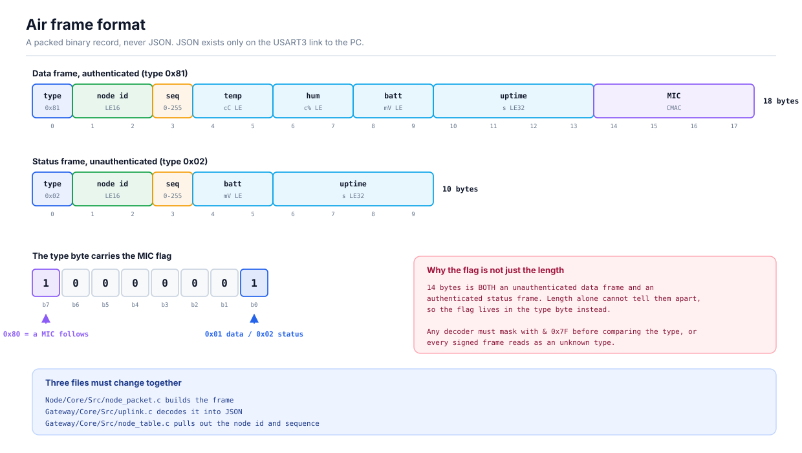

The air link carries a **packed binary record, never JSON**. JSON exists
only on the USART3 link to the PC and inside the EEPROM configuration.

The MIC flag lives in the **type byte**, not in the length, because 14
bytes is both an unauthenticated data frame *and* an authenticated status
frame. Any decoder must mask with `& 0x7F` before comparing the type.

### Authentication

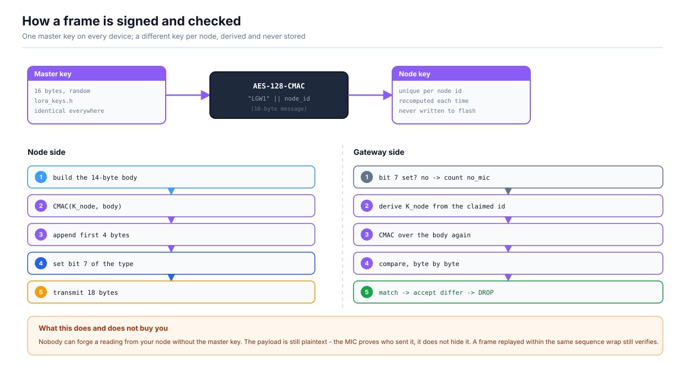

```
K_node = AES-128-CMAC(K_master, "LGW1" || node_id_le16)
MIC    = first 4 bytes of AES-128-CMAC(K_node, frame_body)
```

The MIC covers the type, the node ID *and* the sequence number, so a
forger cannot change the claimed node ID without invalidating it. Neither
MCU has an AES accelerator — the STM32F429 has no CRYP block, that is the
F437/F439 — so both ends run software AES in
[`lora_crypto.c`](Gateway/Core/Src/lora_crypto.c), encrypt-only. It costs
3328 bytes of flash on the gateway and 3064 on the node.

There is no host C compiler in this toolchain, so the FIPS-197 and
RFC 4493 test vectors run **on the target** at boot. Both CMAC padding
branches are covered deliberately — the empty message (K2 path) and one
full block (K1 path) — because that is where CMAC implementations usually
break. The result surfaces as `crypto_ok` in the feed.

---

## 5. Gateway firmware

### Boot

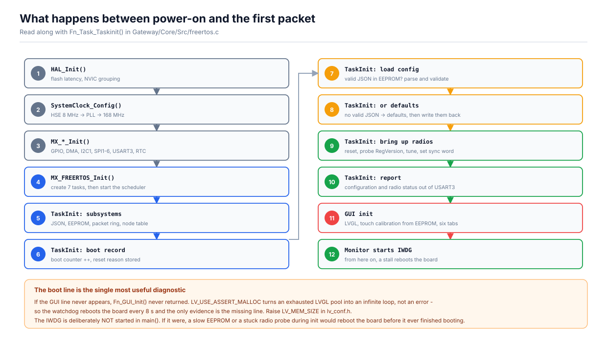

The watchdog is deliberately **not** started in `main()`. If it were, a
slow EEPROM or a stuck radio probe during init would reboot the board
before it ever finished booting. The monitor task starts it once
everything is up.

### Tasks

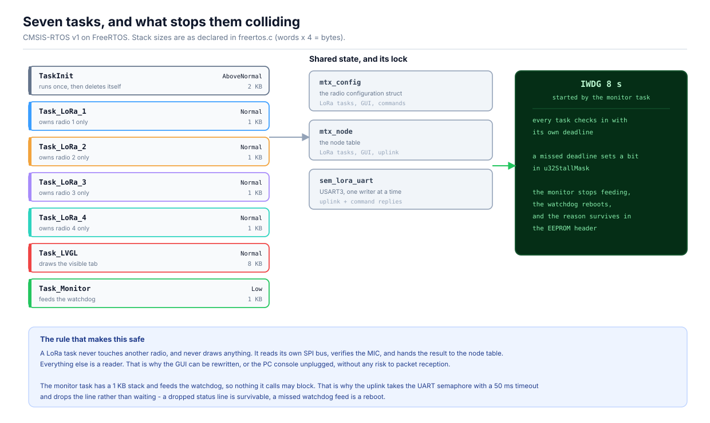

The monitor task has a 1 kB stack and feeds the watchdog, so nothing it
calls may block. That single constraint explains several decisions in the
code — see [§9](#9-the-json-interface).

### The code that matters

**Exact-Hz tuning.** The shared `LoRa.c` driver only accepts whole MHz,
which cannot express 868.100. Both ends write the carrier registers
directly afterwards:

```c
/* Gateway/Core/Src/radio_manager.c
 * FRF = (f_Hz << 19) / 32000000. The shift overflows 32 bits at these
 * frequencies (915e6 << 19 is about 4.8e14), hence the 64-bit
 * intermediate; this runs only when a radio is configured. */
u32Frf = (uint32_t)(((uint64_t)u32Hz << 19) / 32000000ULL);

/* The carrier registers must not be written while transmitting. */
iMode = p->current_mode;
LoRa_gotoMode(p, STNBY_MODE);

LoRa_write(p, RegFrMsb, (uint8_t)(u32Frf >> 16));
LoRa_write(p, RegFrMid, (uint8_t)(u32Frf >> 8));
LoRa_write(p, RegFrLsb, (uint8_t)(u32Frf));
```

The 64-bit intermediate is not optional. `915000000 << 19` is about
4.8 × 10¹⁴, which does not fit in 32 bits; without the cast the radio
tunes to a wrong frequency and the link goes quiet with no error.

**The authenticity gate.** This runs *before* anything else acts on the
frame:

```c
/* Gateway/Core/Src/radio_manager.c
 * Authenticity first: nothing below should act on a frame we have
 * not decided to believe. */
if ((u8RxBuf[u8LoRaSelector][0] & DEF_MIC_TYPE_FLAG) == 0U)
{
    /* No MIC at all - a node not yet reflashed. */
    s->u32RxNoMic++;
    enMic = en_Mic_Absent;

    if (bMicRequired)
    {
        return;
    }
}
else if (Fn_Mic_Verify(au8MasterKey, u8RxBuf[u8LoRaSelector], u8Len))
{
    s->u32RxMicOk++;
    enMic = en_Mic_Ok;
}
else
{
    /* Claimed a MIC and got it wrong. Always dropped, whatever the
     * policy: this is a forgery or a key mismatch, and believing
     * either would defeat the point of having a MIC at all. */
    s->u32RxMicFail++;
    return;
}
```

Note the asymmetry. An *absent* MIC is tolerated while the policy is
report-only, because a node that has not been reflashed yet is a
deployment problem, not an attack. A *wrong* MIC is dropped under either
policy, because there is no innocent explanation for it.

**Duplicate suppression.** A strong node is often heard by two radios at
once:

```c
/* Gateway/Core/Src/node_table.c
 * The same node and sequence again, soon after: one transmission
 * heard twice, typically by two radios. Keep the stronger reading. */
if ((p->u8LastSeq == u8Seq) && (u32Gap < NODE_DUPLICATE_WINDOW_MS))
{
    p->u32Duplicates++;

    if (i16Rssi > p->i16LastRssi)
    {
        p->i16LastRssi = i16Rssi;
        p->i8LastSnr   = i8Snr;
        p->u8Radio     = u8Radio;
    }

    osMutexRelease(mtx_nodeHandle);
    return en_Node_Duplicate;
}
```

This is why **the sequence number must advance on every frame**. A node
that sends a constant sequence is heard once and then silently ignored
forever.

Because the MIC check runs *before* de-duplication, the counters satisfy
an invariant that is useful for spotting double counting:

```
mic_ok + no_mic  ==  good + duplicates
```

### Configuration storage

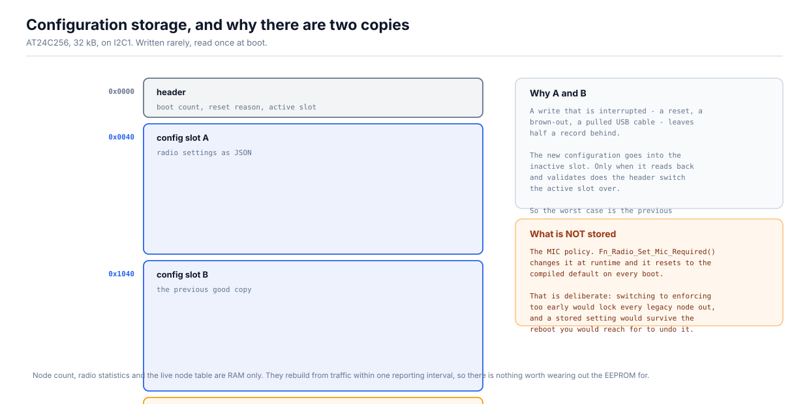

The MIC policy is deliberately **not** persisted. Switching to enforcing
too early would lock every unflashed node out, and a stored setting would
survive exactly the reboot you would reach for to undo it.

---

## 6. Node firmware

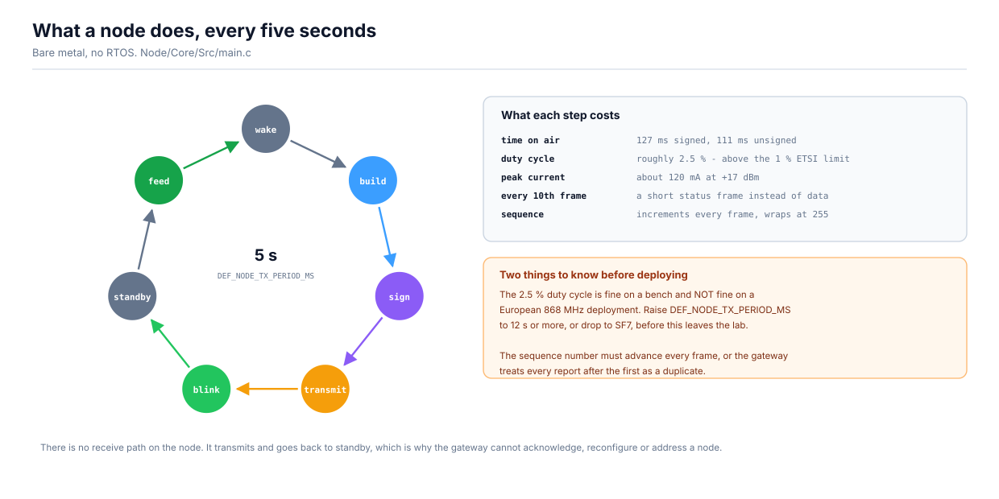

```c
/* Node/Core/Src/node_packet.c */
pu8Buf[0] = (uint8_t)((bStatusFrame ? DEF_NODE_TYPE_STATUS
                                    : DEF_NODE_TYPE_DATA)
#if (DEF_NODE_MIC_ENABLE == 1)
                      | DEF_NODE_TYPE_MIC_FLAG
#endif
                     );
_Fn_Put_U16(&pu8Buf[1], (uint16_t)DEF_NODE_ID);
pu8Buf[3] = u8Seq;

if (bStatusFrame)
{
    _Fn_Put_U16(&pu8Buf[4], sReading.u16BatteryMv);
    _Fn_Put_U32(&pu8Buf[6], sReading.u32UptimeS);
}
else
{
    _Fn_Put_U16(&pu8Buf[4], (uint16_t)sReading.i16TempCc);
    _Fn_Put_U16(&pu8Buf[6], sReading.u16HumidityCp);
    _Fn_Put_U16(&pu8Buf[8], sReading.u16BatteryMv);
    _Fn_Put_U32(&pu8Buf[10], sReading.u32UptimeS);
}

#if (DEF_NODE_MIC_ENABLE == 1)
/* Covers everything already written, so the type, node ID and
   sequence number are all authenticated: a forger cannot change the
   claimed node ID without invalidating the MIC. */
Fn_Mic_Compute(au8NodeKey, pu8Buf, (uint16_t)u8Body, &pu8Buf[u8Body]);
#endif
```

**There is no sensor fitted.** `node_packet.c` synthesises a plausible
reading with a random walk seeded from the MCU's unique ID, which is what
makes four identical boards produce four different but repeatable series.
Replace that one function with a real driver and nothing else changes.

### Each node is its own build

Identity and frequency are compile-time constants:

```c
/* Node/Core/Inc/node_config.h */
#define DEF_NODE_ID        1002U       //1003U      //1004U      //1001U
#define DEF_NODE_FREQ_HZ   900000000UL //915000000UL//880000000UL//868100000UL
```

Edit both lines for the board in front of you, **then** build, **then**
flash. Getting this wrong produces a failure that is genuinely hard to
read: during development a board was flashed while the header still held
another node's identity, which gave two boards transmitting as node 1004
on 880 MHz and a completely dead 900 MHz channel. The tell is two
interleaved sequence streams with different uptimes on one radio —
[`docs/08-Troubleshooting.md`](docs/08-Troubleshooting.md) §8.2 shows what
that looks like.

Debug state is parked at a fixed address so it can be read over SWD
without a UART:

```c
/* Node/Core/Src/main.c — readable at 0x2000008C in the debugger */
volatile StructNodeStats sNodeStats;
```

---

## 7. The touch display

Six tabs. Everything below is on the device itself — no PC required.

### Home — one card per radio

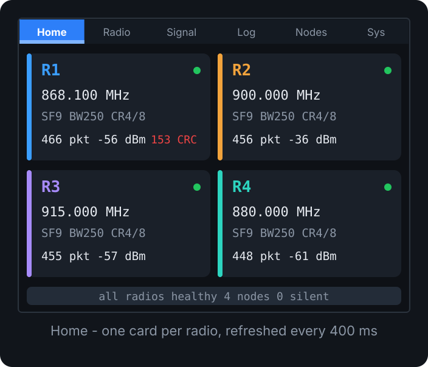

Frequency, modem settings, packet count and last RSSI per radio, with a
status dot. The banner at the foot turns into a warning when a radio stops
responding or a node goes silent.

### Radio — edit any radio, on the device

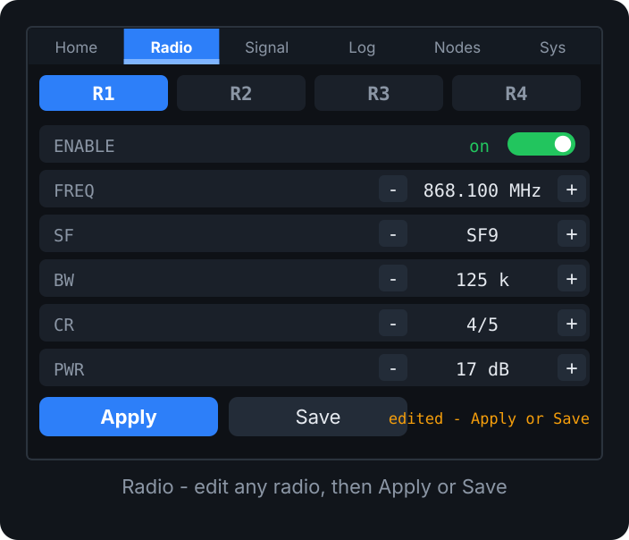

Pick a radio, change enable, frequency, spreading factor, bandwidth,
coding rate and power. **Apply** takes effect immediately but is lost at
reboot; **Save** writes it to EEPROM. The edit is staged in a local copy
and validated before anything is applied, so an invalid combination is
rejected rather than half-applied. The frequency stepper repeats when
held.

### Signal — RSSI and packet size

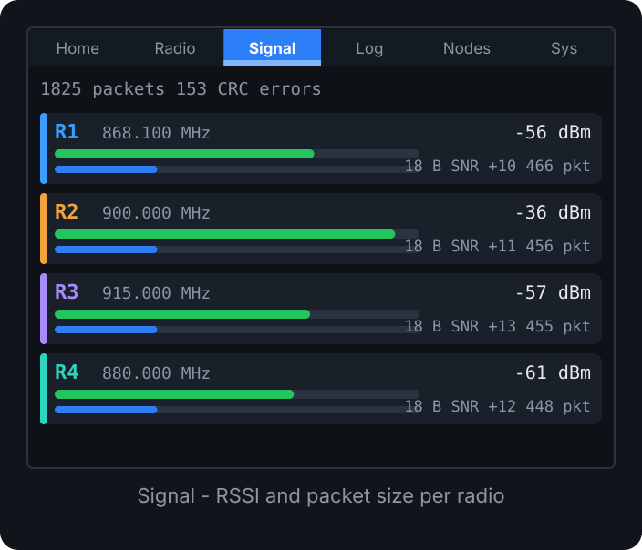

A bar per radio, scaled −120…−30 dBm and coloured by quality, with the
payload size underneath. This is the screen for aiming an antenna.

### Log — all four channels in one stream

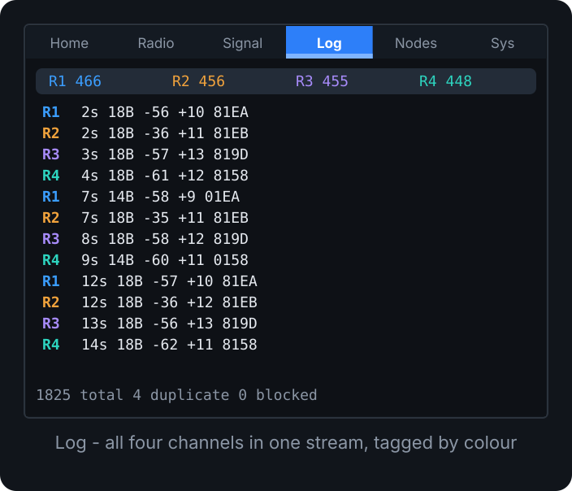

Age, length, RSSI, SNR and the first two bytes of every frame. The radio
tag is colour-coded with the same four colours used everywhere else, so
one channel can be followed down the page without reading the numbers.

### Nodes — one row per end node

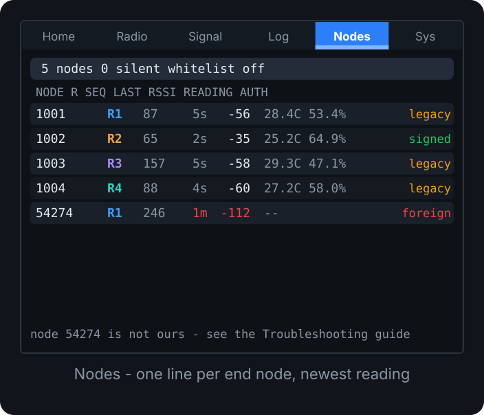

Sequence, time since last heard, signal, the decoded reading, and the
authentication state: **signed**, **legacy** (no MIC) or a node that is
not yours at all.

### Sys — health of the gateway itself

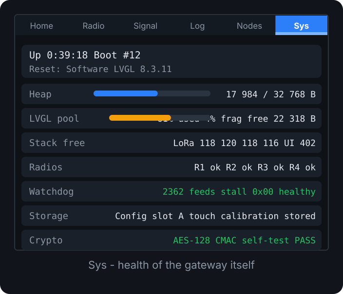

Uptime, boot count, reset reason, free heap, LVGL pool usage, per-task
stack headroom, radio status, watchdog feeds and stall mask, the active
EEPROM slot, and the crypto self-test result.

> **Watch the LVGL pool figure.** `LV_USE_ASSERT_MALLOC` turns an
> exhausted pool into an infinite loop, not an error message. The symptom
> is a board that reboots every 8 s with no explanation. Past about 80 %,
> raise `LV_MEM_SIZE` in `lv_conf.h` before adding widgets.

---

## 8. The PC console

One Python file and one HTML file. No framework, no CDN, no build step —
the only dependency outside the standard library is `pyserial`.

```bash
cd PC_Console && python lora_bridge.py
```

The port is auto-detected; the gateway shows up as **ST-Link Virtual COM
Port**. A browser opens on `http://127.0.0.1:8787`.

### Dashboard

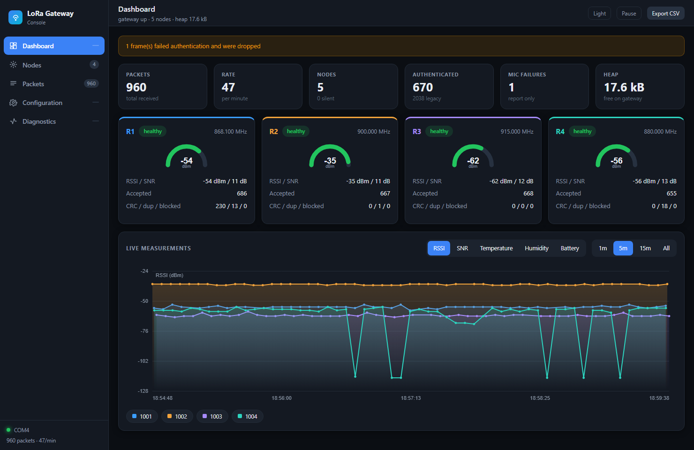

Six KPIs, a card per radio with an RSSI gauge, and a live chart that
switches between RSSI, SNR, temperature, humidity and battery over 1 m /
5 m / 15 m / all. The banner at the top appears when something needs
attention — here, one frame that failed authentication.

### Nodes

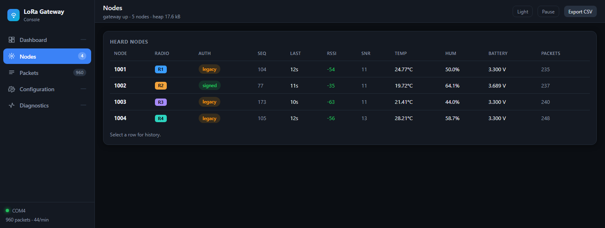

Every node heard, with its authentication badge. Click a row for its
history.

### Packets

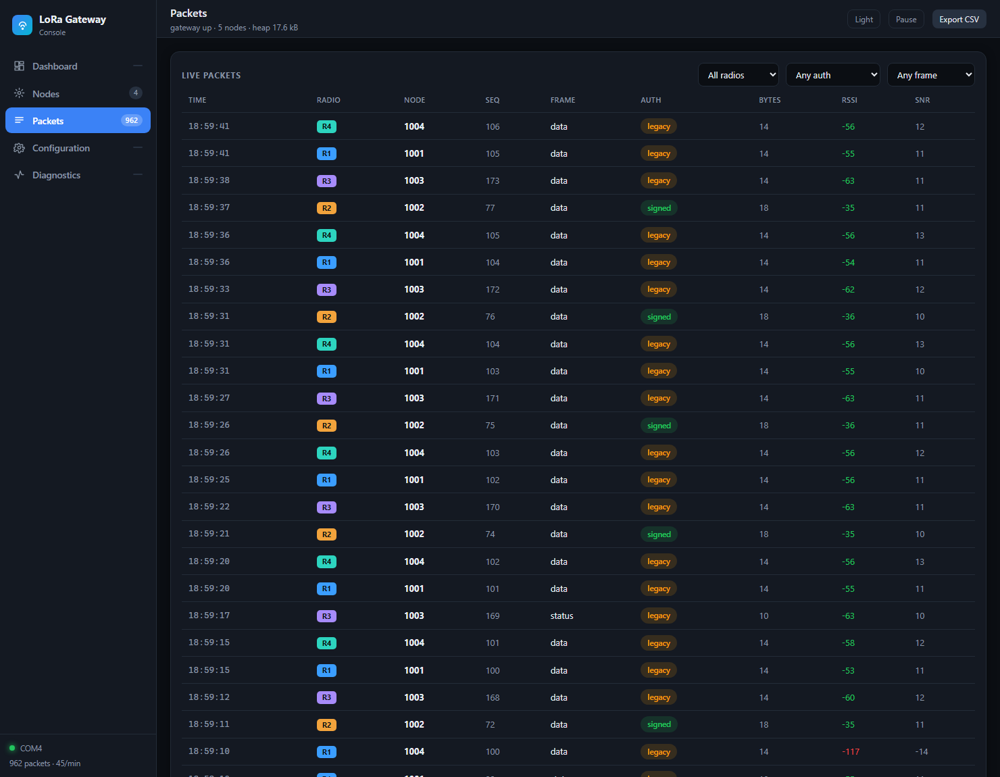

The live stream, filterable by radio, node and frame type, with a frame
inspector that maps each byte back onto the layout in
[§4](#4-the-radio-link).

### Configuration

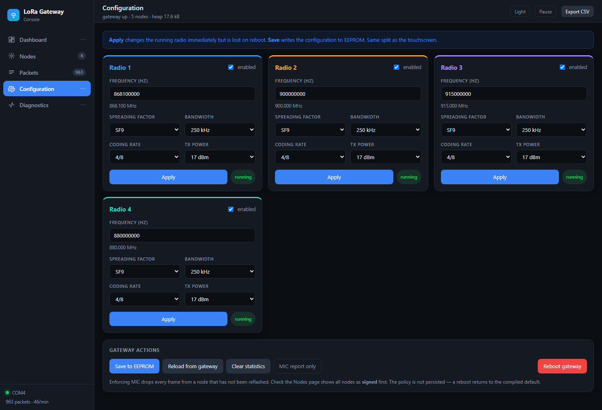

The same settings as the Radio tab on the device, with the same rules
mirrored client-side so an invalid value is caught before it is sent. The
gateway validates independently and refuses anything bad:

```json
{"ok":0,"err":"invalid or under 2 MHz spacing"}
```

### Diagnostics

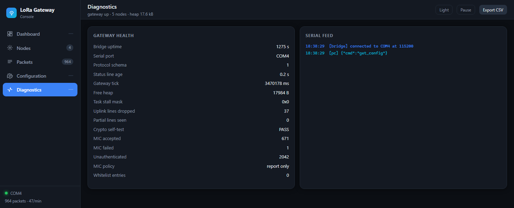

Bridge uptime, protocol schema, gateway tick, free heap, task stall mask,
dropped uplink lines, partial lines, the crypto self-test, the MIC
counters and the raw serial feed.

---

## 9. The JSON interface

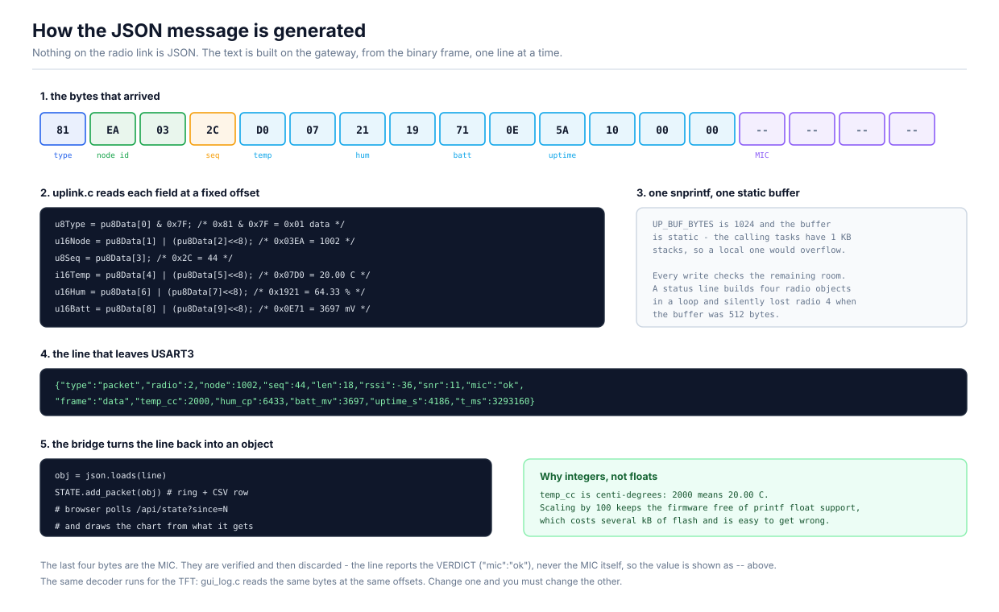

Nothing on the radio link is JSON. The text is built on the gateway, from
the binary frame, one line at a time, by `uplink.c`.

### Out of the gateway

| Line | When |
|---|---|
| `hello` | once at boot |
| `packet` | every accepted frame |
| `status` | every 2 s |

```json
{"type":"packet","radio":2,"node":1002,"seq":44,"len":18,"rssi":-36,
 "snr":11,"mic":"ok","frame":"data","temp_cc":2000,"hum_cp":6433,
 "batt_mv":3697,"uptime_s":4186,"t_ms":3293160}
```

`temp_cc` is centi-degrees: 2000 means 20.00 °C. Scaling by 100 keeps the
firmware free of printf float support, which costs several kB of flash and
is easy to get wrong.

### Into the gateway

`ping`, `get_config`, `get_nodes`, `set_radio`, `save`, `clear_stats`,
`set_mic_policy`, `reboot` — each answered with exactly one `ack` line.

RX is interrupt-driven, and that is not a style choice: the command task
runs every 200 ms, and at 115200 baud roughly 2000 bytes arrive in that
window. Polling would lose almost all of them.

### Why the uplink is allowed to give up

Its callers are the four radio tasks and the monitor task — and the
monitor task feeds the watchdog:

```c
/* Gateway/Core/Src/uplink.c */
static bool _Fn_Lock (void)
{
    if (osSemaphoreWait(sem_lora_uartHandle, DEF_UPLINK_SEM_WAIT_MS) != osOK)
    {
        u32Dropped++;
        return false;
    }
    return true;
}
```

A dropped status line is survivable. A missed watchdog feed is a reboot.
The `dropped` counter on the Diagnostics page is that trade-off made
visible — it is backpressure working, not a fault.

Buffers in this path are `static` for the same reason: those tasks have
1 kB stacks with roughly 480 bytes spare, and a `StructLoRaConf` copy
alone is ~280 bytes.

---

## 10. User guide

### First power-up

1. Screw an antenna onto **every** radio before powering up. Transmitting
   into an open SMA connector damages the PA.
2. Connect the Nucleo's USB to the PC. The board powers from USB.
3. The display shows the **Home** tab within a couple of seconds.
4. If crosshairs appear instead, touch each one — that is the touch
   calibration, and it is stored in EEPROM so it only happens once.

### Checking the link

| Look at | Expected |
|---|---|
| Home | four cards, each showing its frequency |
| Home, after ~5 s | packet counts start climbing |
| Sys | stall mask `0x00`, crypto self-test PASS |
| Node LED | one short flash every 5 s |

If a radio stays at zero, work through
[`docs/08-Troubleshooting.md`](docs/08-Troubleshooting.md) §8.1 — the
checks are ordered by how often each one turns out to be the cause.

### Changing a radio's settings

On the device: **Radio** tab → pick the radio → adjust → **Apply** to test
→ **Save** to keep it across reboots.

From the PC: **Configuration** page → edit → **Apply** → **Save**.

Remember that a node is built for one frequency. Changing a gateway radio
without reflashing its node silences that channel.

### Reading the data

- **On the device:** Signal for aiming, Log for raw traffic, Nodes for
  decoded readings.
- **On the PC:** Dashboard for trends, Packets for individual frames,
  **Export CSV** for anything else.

The bridge also writes `packets.csv` continuously next to the script.

---

## 11. Build and flash

### What you need

- **STM32CubeIDE** 1.13 or newer (GCC toolchain and ST-LINK included).
  v1.0.0 was built with 1.19.0 / GCC 13.3 rel1, `Release` configuration.
- **Python 3.9+** with `pyserial` for the console

If you only want to run the device, skip this section entirely and take
the binaries from [Release v1.0.0](../../releases/tag/v1.0.0). Come back
here when you want your own key, your own channel plan, or a real sensor.

### Both projects

Import `Gateway/` and `Node/` into a CubeIDE workspace with
*File → Import → Existing Projects into Workspace*, then build and flash
each with the ST-LINK.

### Before the first build — the key

The repository ships a **published example key** so the projects build out
of the box. It is printed in a public repository and is therefore not
secret. Generate your own:

```bash
python -c "import secrets; print(', '.join('0x%02XU' % b for b in secrets.token_bytes(16)))"
```

Paste it into the macro in **both** `Gateway/Core/Inc/lora_keys.h` and
`Node/Core/Inc/lora_keys.h`. The two files must be **byte for byte
identical**, and changing the key means reflashing every device in the
network together.

### Flashing a node

1. Edit `DEF_NODE_ID` and `DEF_NODE_FREQ_HZ` in
   `Node/Core/Inc/node_config.h` for *the board physically in front of
   you*.
2. Build.
3. Flash.

Confirm which board is on the probe before you press build. See
[§6](#6-node-firmware).

### If the gateway will not build

`lvgl.h: No such file or directory` means the include path has been lost
from `.cproject`, usually because CubeMX regenerated code from the `.ioc`.
Add `../Middlewares/Third_Party/lvgl` back to the include paths in **both**
Debug and Release.

Do **not** fix it by editing `Debug/**/subdir.mk`. That file is
regenerated and your change will vanish at the next IDE build — which is
exactly how the fault was introduced in the first place.

---

## 12. Security

**What the MIC gives you:** nobody can forge a reading that appears to
come from your node without the master key. Because the MIC covers the
node ID and the sequence number, an attacker cannot even relabel a
captured frame as a different node.

**What it does not give you:**

| Not provided | Consequence |
|---|---|
| Confidentiality | the payload is plaintext — readable, just not forgeable |
| Freshness | a frame replayed within one sequence wrap (~21 min at 5 s) still verifies |
| Key secrecy on-device | the key is in the binary; anyone who can read flash can read it |

**Before deploying:** set your own key, set **RDP level 1** on the parts,
and move the key to a dedicated EEPROM slot written at provisioning —
outside the A/B config slots, so a factory reset cannot orphan deployed
nodes. Closing the replay window needs a per-node sequence window that
tolerates node reboots. None of that is implemented here.

### Rolling out authentication

The policy defaults to **report-only**: unsigned frames are accepted and
counted, so the network keeps working while nodes are reflashed one at a
time. Only when the Nodes page shows every node as **signed** should you
switch to enforcing. Flipping it early silences every node that has not
been reflashed yet.

---

## 13. Limitations, read this before deploying

**The duty cycle is over the legal limit for EU 868.** At SF9/BW250/CR4-8
a signed data frame is about 127 ms on air; one every 5 s is roughly
**2.5 %**, against the 1 % that ETSI allows in the 868.0–868.6 sub-band.
Five seconds is a deliberate *bench* rate — it makes the screens move
while the link is being brought up. Raise `DEF_NODE_TX_PERIOD_MS` to at
least 13 s, or drop the spreading factor, before this leaves a lab.

**The channel plan is not legal everywhere.** 868.100 MHz is EU; 880, 900
and 915 MHz are not free spectrum in most of Europe or in India, where the
licence-free band is 865–867 MHz. Choose frequencies against the rules
that apply where the device actually runs.

**R1 has a ~25 % CRC error rate, and it is not a fault.** 868.100 MHz is
EU868 channel 0 — the default first channel in essentially every LoRaWAN
stack — and sync word `0x12` is the default in nearly every Arduino and
RadioHead LoRa library. So the gateway hears other people's equipment:
frames of 150–180 bytes, 20 dB below the noise floor, from node IDs that
do not exist in this network. Most fail CRC; a few get through and appear
as phantom nodes. **Moving R1 to 890.000 MHz would clear both symptoms at
once** — it is 10 MHz from R4 and R2, 25 MHz from R3, and well inside the
2 MHz spacing rule. That change is *not* applied in this repository: the
documented channel plan matches the hardware as it actually runs. Changing
it means reflashing node 1001 to match in the same session.

**There is no downlink.** Nodes cannot be acknowledged, reconfigured or
addressed over the air.

**The node table is RAM only.** It rebuilds from traffic within one
reporting interval, so there is nothing worth wearing out the EEPROM for —
but a reboot does reset every count.

---

## 14. Repository layout

```
TetraGate/
├── Gateway/        STM32F429ZI firmware - CubeIDE project
│   └── Core/Src/   radio_manager, node_table, uplink, gw_command,
│                   lora_crypto, gui_*, eeprom_operation
├── Node/           STM32G030F6P6 firmware - CubeIDE project
│   └── Core/Src/   node_radio, node_packet, lora_crypto
├── PC_Console/     lora_bridge.py + dashboard.html
├── Datasheets/     RFM95W, STM32G030F6P6, Anchor board, AT24C256
├── docs/           the manuals, and every figure in this README
└── README.md
```

| Document | What it covers |
|---|---|
| [01-Architecture](docs/01-Architecture.md) | the design, in prose |
| [02-Air-Protocol](docs/02-Air-Protocol.md) | frame format and channel plan in detail |
| [03-Gateway-Firmware](docs/03-Gateway-Firmware.md) | file-by-file walkthrough |
| [04-Node-Firmware](docs/04-Node-Firmware.md) | file-by-file walkthrough |
| [05-PC-Console](docs/05-PC-Console.md) | bridge and browser console |
| [06-User-Guide](docs/06-User-Guide.md) | operating the device |
| [07-Build-and-Flash](docs/07-Build-and-Flash.md) | toolchain detail |
| [08-Troubleshooting](docs/08-Troubleshooting.md) | symptom-first, every entry a fault that really happened |

`LoRa.c` is a hardware-proven driver shared, byte for byte, by both
projects. Extend it additively; do not rewrite it.

---

## License

MIT — see [LICENSE](LICENSE).

The vendored LVGL under `Gateway/Middlewares/Third_Party/lvgl` and cJSON
keep their own licences.
