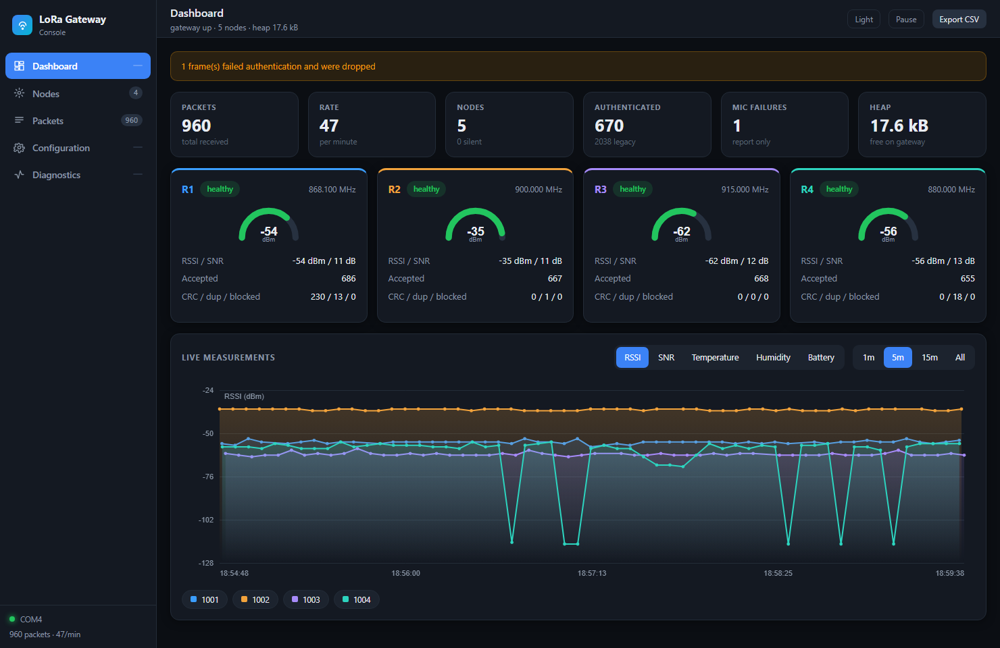
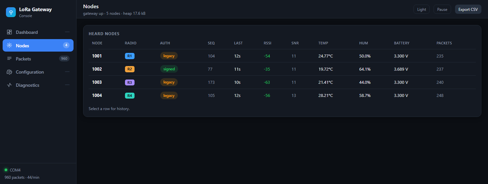
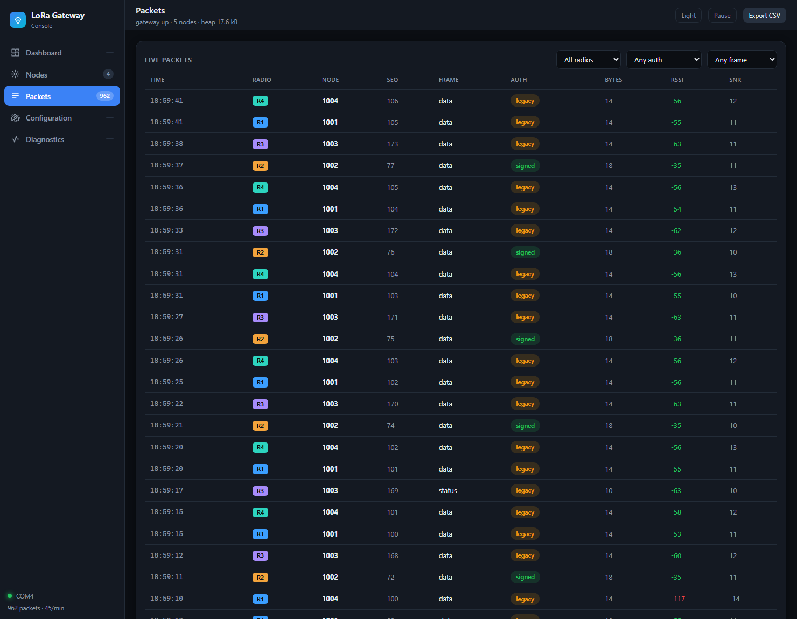
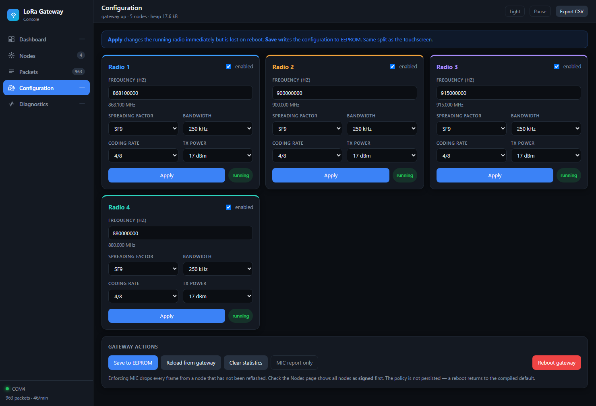

# 5. The PC Console

Two files in `PC_Tool/`:

| File | Role |
|---|---|
| `lora_bridge.py` | opens the serial port, keeps history, logs CSV, serves the UI |
| `dashboard.html` | the browser console |
| `run_dashboard.bat` | Windows double-click launcher |

---

## 5.1 Why a browser and not a desktop window

Three reasons, in order of weight:

1. **Dependencies.** The only third-party package needed is `pyserial`,
   which was already installed. PySide6 or matplotlib would be a ~100 MB
   install for a worse chart.
2. **A browser cannot open a serial port** from a hosted page, so the
   page has to be served locally regardless — at which point the Python
   side is doing the serial work anyway.
3. **The UI is far easier to make good** in HTML/CSS than in a widget
   toolkit, and this one needed to be good.

The charts are hand-written on `<canvas>` with **no CDN**, so the
console works on a bench with no internet.

---

## 5.2 The bridge

### Thread model

```
main thread            serial thread              HTTP threads
───────────            ─────────────              ────────────
HTTP server            read lines                 GET  /api/state
                       parse JSON                 POST /api/command
                       update State  ◀── lock ──▶  read State
                       write CSV                  write serial
```

One `State` object with a lock holds everything; a second lock
serialises writes to the port:

```c
# One writer at a time: two commands interleaved on the wire
# would arrive as one unparseable line.
with self.write_lock:
    ser.write(line)
    ser.flush()
```

### Tolerating broken lines

```python
try:
    obj = json.loads(line)
except json.JSONDecodeError:
    with STATE.lock:
        STATE.parse_errors += 1
    STATE.add_log(f"[partial] {line[:80]}")
    continue
```

A gateway reset cuts a line in half mid-transmission. That is normal,
not an error: the fragment is counted and kept as a log line rather than
crashing the parser or being silently dropped. The count is visible on
the Diagnostics page.

### Merging, not replacing, the per-node view

```python
view = self.nodes.setdefault(node, {"node": node, "packets": 0})
view["packets"] += 1
for key in ("radio", "seq", "rssi", "snr", "len", "frame", "mic",
            "temp_cc", "hum_cp", "batt_mv", "uptime_s"):
    if key in obj:
        view[key] = obj[key]
```

Status frames carry no temperature or humidity. Replacing the view
wholesale would blank those columns every tenth packet; merging keeps
the last known reading.

### Incremental polling

The browser sends the highest packet index it has seen:

```python
if since <= 0:
    sel = list(self.packets)[-FIRST_LOAD_MAX:]
else:
    sel = [p for p in self.packets if p["i"] > since]
```

A fresh page load gets the last 3000 packets; every poll after that gets
only what is new.

### HTTP surface

| Route | Purpose |
|---|---|
| `GET /` | the console page |
| `GET /api/state?since=N` | everything new since packet N |
| `POST /api/command` | forwards a JSON command to the gateway |

The bridge asks the gateway for its configuration as soon as it
connects, so the Configuration page is populated without the user doing
anything:

```python
STATE.send_command({"cmd": "get_config"})
```

---

## 5.3 The console

### Dashboard



KPI row, then one card per radio with a signal gauge, then the live
chart. Five metrics (RSSI, SNR, temperature, humidity, battery) and four
time windows; click a legend chip to hide a node; hover for a crosshair
readout.

The gauge has an explicit empty state:

```js
if (!heard){
  return `... <text ...>no signal</text></svg>`;
}
```

> A radio that has heard nothing reports RSSI 0, which is numerically a
> very strong signal and would otherwise paint a **full green arc on a
> dead channel** — the most misleading thing this screen could do. That
> was a real bug, visible in an early screenshot.

### Nodes



One row per node with an **Auth** column: *signed* (green) for a node
with a valid MIC, *legacy* (amber) for one not yet reflashed, *bad MIC*
(red) if verification failed. Click a row for history charts.

### Packets



Live stream, filterable by radio, authentication state and frame type.
Click a row for an inspector showing the decoded fields and the frame
layout with byte offsets.

### Configuration



Per-radio forms, plus gateway actions. **Apply** sends `set_radio` and
takes effect immediately; **Save** writes EEPROM. Same split as the
touchscreen.

Client-side validation mirrors the firmware so a bad value is caught
with a clear message instead of coming back as a bare refusal:

```js
function validate(body, cfg){
  if (body.freq < FREQ_MIN || body.freq > FREQ_MAX)
    return `Frequency must be 868-915 MHz`;
  if (!body.en) return null;
  for (const r of cfg.radios){
    if (r.n === body.n || !r.en) continue;
    if (Math.abs(r.freq - body.freq) < SPACING)
      return `Too close to R${r.n} ... needs 2 MHz spacing`;
  }
  return null;
}
```

The gateway validates independently — the browser check is a courtesy,
not the enforcement.

### Diagnostics

Gateway health (heap, stall mask, crypto self-test, MIC counters) and
the raw serial feed, colour-coded by source.

---

## 5.4 Logging

Every packet is appended to `PC_Tool/packets.csv` as it arrives:

```
iso_time,radio,node,seq,frame,mic,len,rssi_dbm,snr_db,temp_c,humidity_pct,battery_mv,node_uptime_s,gateway_t_ms
```

Temperature and humidity are written as decimal degrees and percent —
the conversion from the on-air centi-units happens here, so the CSV
opens cleanly in a spreadsheet.

The **Export CSV** button downloads only what the browser currently
holds; the file on disk is the complete record.

Next: [06-User-Guide.md](06-User-Guide.md)
